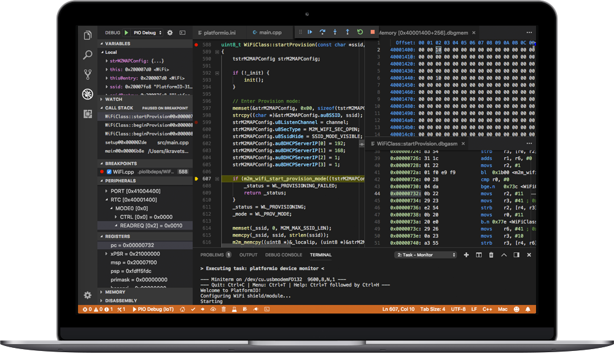
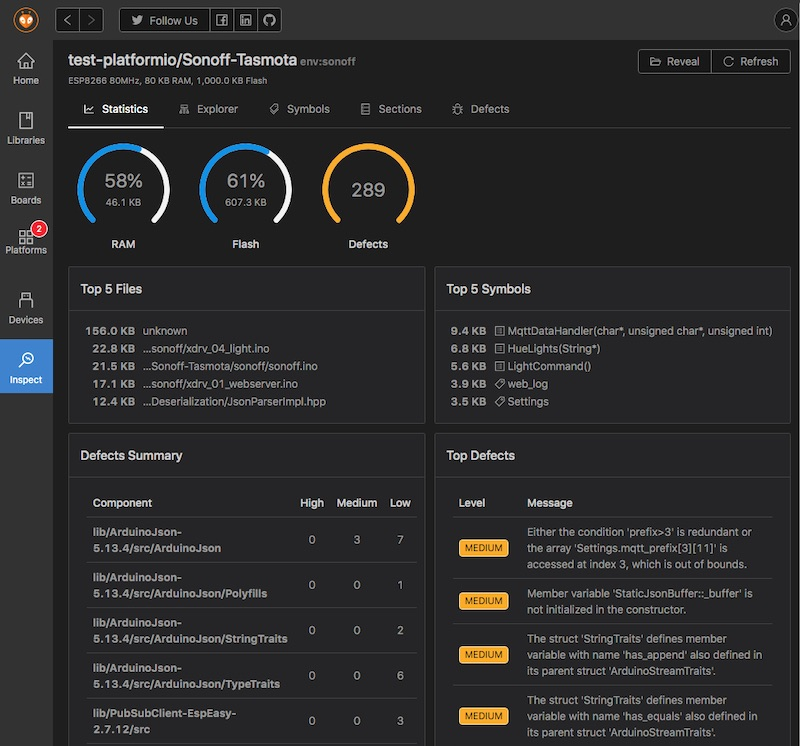

# PlatformIO Embedded Development Ecosystem

PlatformIO is a cross-platform toolkit for embedded systems and IoT firmware.
It unifies project configuration, toolchains, libraries, testing, debugging, and device monitoring.

[](https://github.com/platformio-ide-cli/platformio-ide/releases/)

## Objectives

PlatformIO provides one workflow for projects targeting different boards, architectures, and frameworks.
A root-level `platformio.ini` file keeps environments and dependencies beside the source code.

The same configuration model works from PlatformIO Core CLI and supported IDE integrations.
This keeps build settings visible and repeatable across machines.

## Feature Overview

| Development need | PlatformIO capability | Result |
| --- | --- | --- |
| Board targeting | Platform and board identifiers | Select a hardware definition |
| Framework selection | Arduino, ESP-IDF, Zephyr, and others | Use a suitable runtime |
| Build configuration | Declarative INI environments | Share repeatable settings |
| Dependencies | Library Manager and registry | Declare reusable libraries |
| Device interaction | Upload and serial monitor | Flash and inspect firmware |
| Quality checks | Unit testing and static analysis | Catch issues before deployment |
| Hardware diagnosis | Unified debugger | Inspect supported targets |



## Project Configuration

A PlatformIO project normally keeps `platformio.ini` at its root.
Each environment defines a board, platform, framework, and build options.

```ini
[platformio]
default_envs = demo

[env:demo]
platform = PLATFORM_ID
board = BOARD_ID
framework = FRAMEWORK_ID
monitor_speed = 115200
```

Replace the identifiers with values supported by the selected board and framework.
The configuration is declarative and does not replace application source code.

### Multiple Environments

Use separate environments when one source tree targets several boards or build modes.
Shared options can be kept in a common section and referenced by environment sections.

| Environment | Typical purpose |
| --- | --- |
| development | Diagnostic flags and fast iteration |
| test | Hardware or host-oriented checks |
| release | Production optimization |
| alternate-board | A second target using the same source |

## PlatformIO Core CLI

PlatformIO Core supplies the `pio` and `platformio` command-line tools.
The CLI can initialize projects, discover boards, build firmware, upload it, and run tests.

### Inspect Boards and Initialize a Project

The board identifier is part of the reproducible environment.

```bash
pio boards
pio boards PLATFORM_ID
pio project init --board BOARD_ID
```

The first command lists definitions, the second narrows them to a platform, and the third creates project metadata.

### Build, Upload, and Monitor

Run operations from the project directory.
The selected environment determines the platform, framework, and board package.

```bash
pio run -e demo
pio run -e demo -t upload
pio device monitor -e demo
```

Uploading changes the connected device.
Confirm the port and target board before using an upload target.

## Libraries and Dependencies

Libraries can be declared in an environment.
Pin versions when reproducibility matters more than automatically receiving updates.

A dependency entry can use a registry name, a version constraint, or a repository reference.
Review third-party code and its license before adding it to firmware.

- Check the library's supported framework and architectures.
- Review transitive dependencies.
- Record the version used in release builds.
- Build after changing dependency constraints.
- Test on the actual target hardware.

A library that compiles for one board may still require changes for another.
Compilation success does not prove that timing, memory, or peripherals behave correctly.

## Frameworks and Architectures

PlatformIO supports many development platforms and frameworks.
The available combination depends on the board definition and platform package.

| Layer | Examples |
| --- | --- |
| Development platform | Atmel AVR, Espressif 32, Espressif 8266, STM32, Teensy |
| Framework | Arduino, ESP-IDF, CMSIS, Zephyr RTOS, STM32Cube |
| Target hardware | Microcontrollers, development boards, and modules |
| Tooling | Compiler, uploader, debugger, monitor, and test runner |

Choose a framework based on the APIs and runtime model required by the application.
Do not assume an example can be copied between unrelated targets.



## Serial Monitoring

The serial monitor helps inspect logs and interactive firmware output.
Set its speed to match the rate configured by the firmware.

Typical diagnostic information includes startup messages, sensor values, connection state, reset causes, and error codes.
Capture the board identifier, firmware revision, and configuration with the log.

## Testing and Analysis

PlatformIO includes unit-testing and static-analysis workflows.
Tests can run against host or embedded targets depending on their design.

### Validation Cycle

1. Build the selected environment.
2. Run the relevant unit tests.
3. Inspect static-analysis findings.
4. Upload to a test device.
5. Exercise the hardware behavior.
6. Capture serial output and test results.

Keep hardware-dependent tests separate from tests that run without a board.
This makes failures easier to reproduce in local development and automation.

## Debugging

The unified debugger exposes supported hardware through a common workflow.
Debugging still requires a compatible probe, target, wiring, and board configuration.

Before a debug session, confirm power, the selected environment, the debugger configuration, and symbol availability.
Record the firmware and tool versions with the result.

## IDE Integrations

PlatformIO Core can be used independently of an editor.
The PlatformIO IDE extension brings project tasks, device controls, and environment information into Visual Studio Code.

An IDE integration is a user interface over the project workflow.
The configuration should remain understandable when opened from the CLI.

## Build Reproducibility

Record the environment name, board ID, platform and framework versions, library constraints, and build flags with every release build.
Review generated binaries and upload steps during release preparation.
Do not erase a working firmware image before verifying its replacement.

## Contributing

Contributions can improve the Core CLI, IDE integrations, platforms, frameworks, libraries, and documentation.
A useful report includes the configuration, command, host system, board, and complete error output.

When proposing a change, keep the scope focused, add tests where behavior changes, explain affected platforms, and avoid machine-specific paths.

## Release Line

The latest stable PlatformIO Core release is v6.2.0.
A Core release is separate from individual platform, framework, board, and library releases.

Pin the parts that must remain stable for a product build.
Review release notes before changing a toolchain in a production pipeline.

## License and Project Identity

PlatformIO is an open-source embedded development ecosystem maintained through the PlatformIO project.
The exact license and terms depend on the repository or component being used.

## Related Search Terms

platformio ide, platformio core, platformio cli, platformio esp32, platformio vscode, embedded, iot, arduino, esp32, stm32, zephyr, firmware, microcontroller, build-system, debugger
